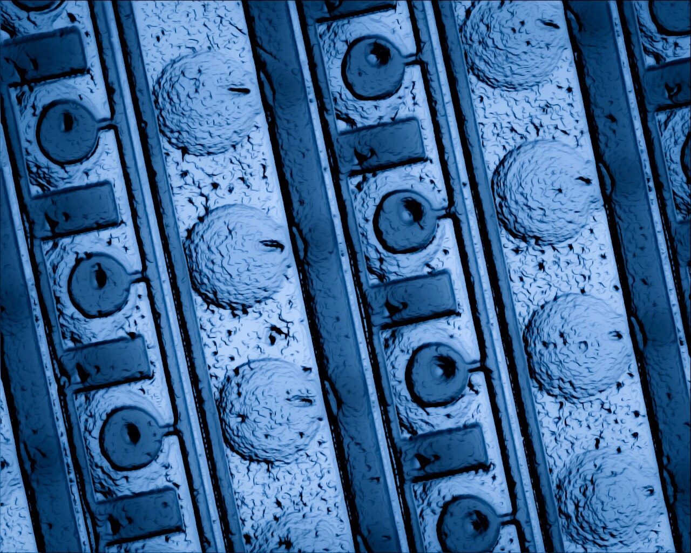
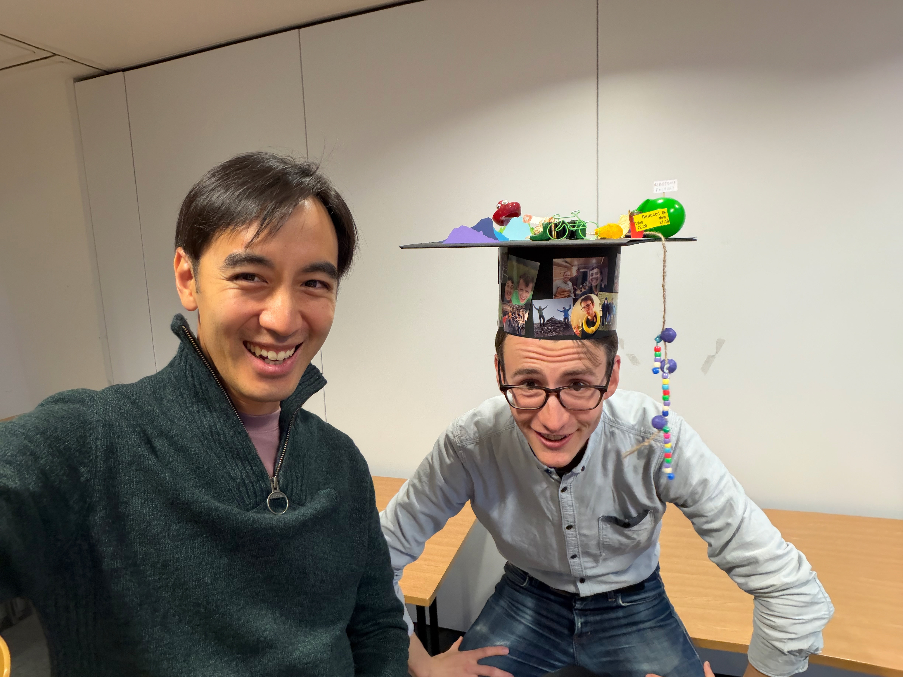
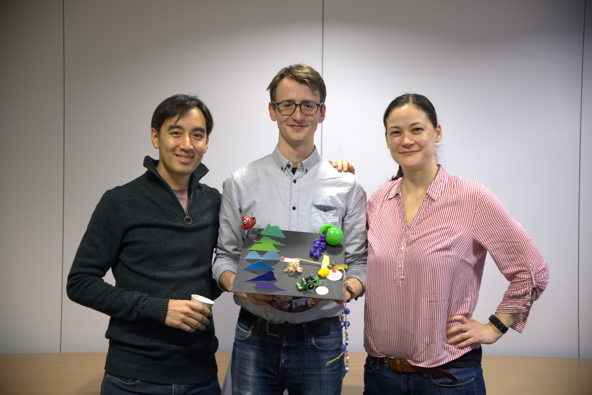
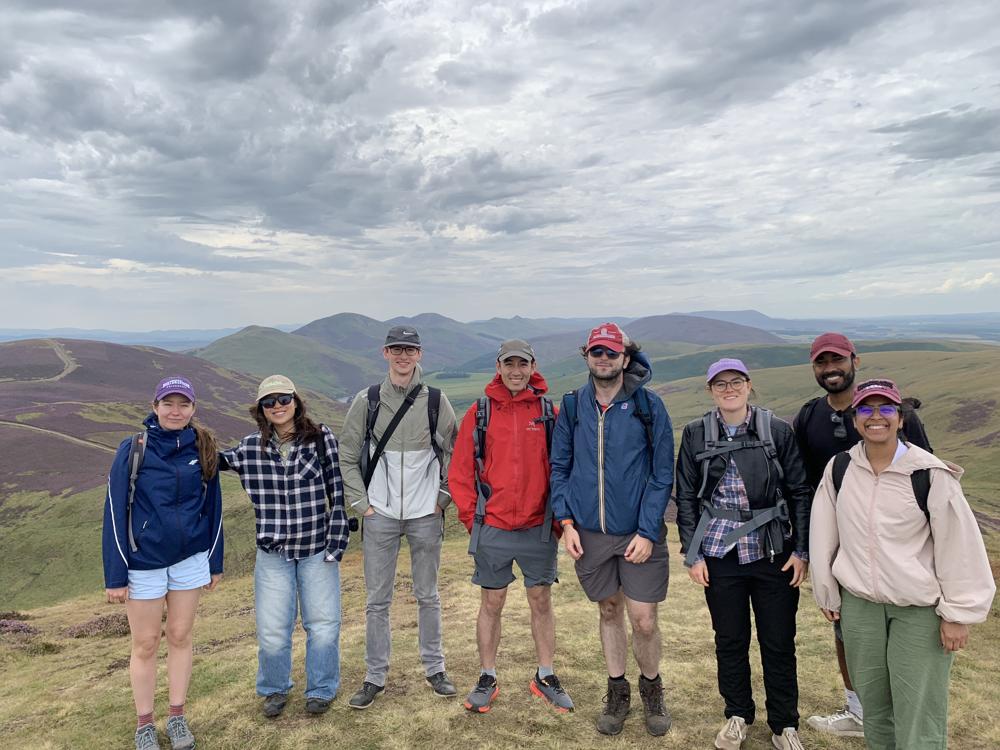
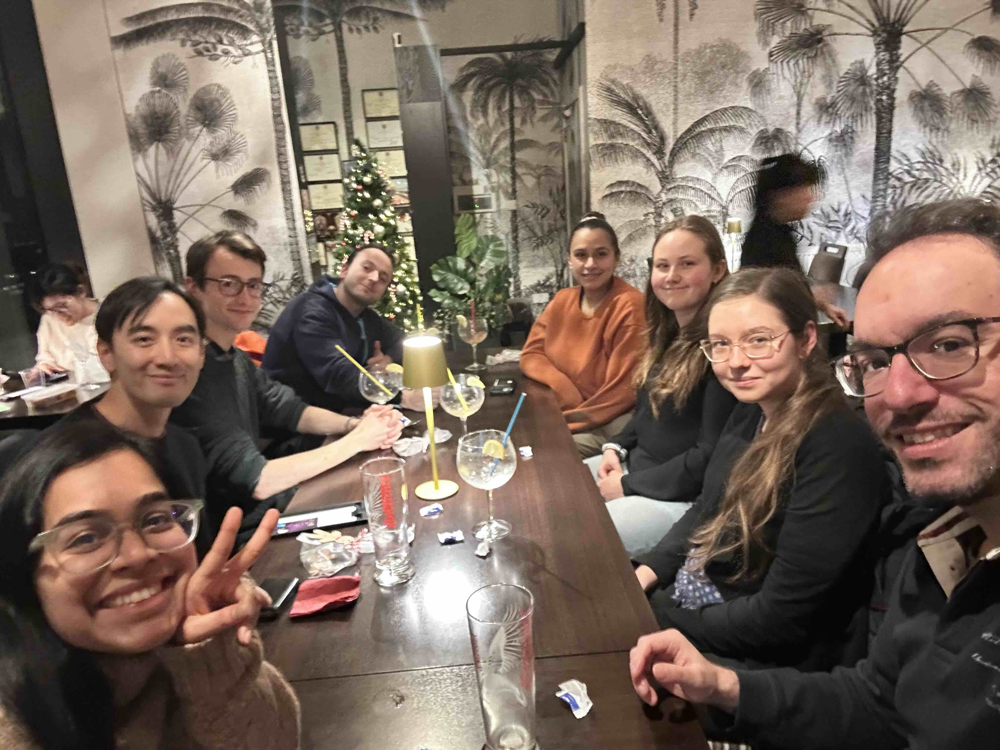
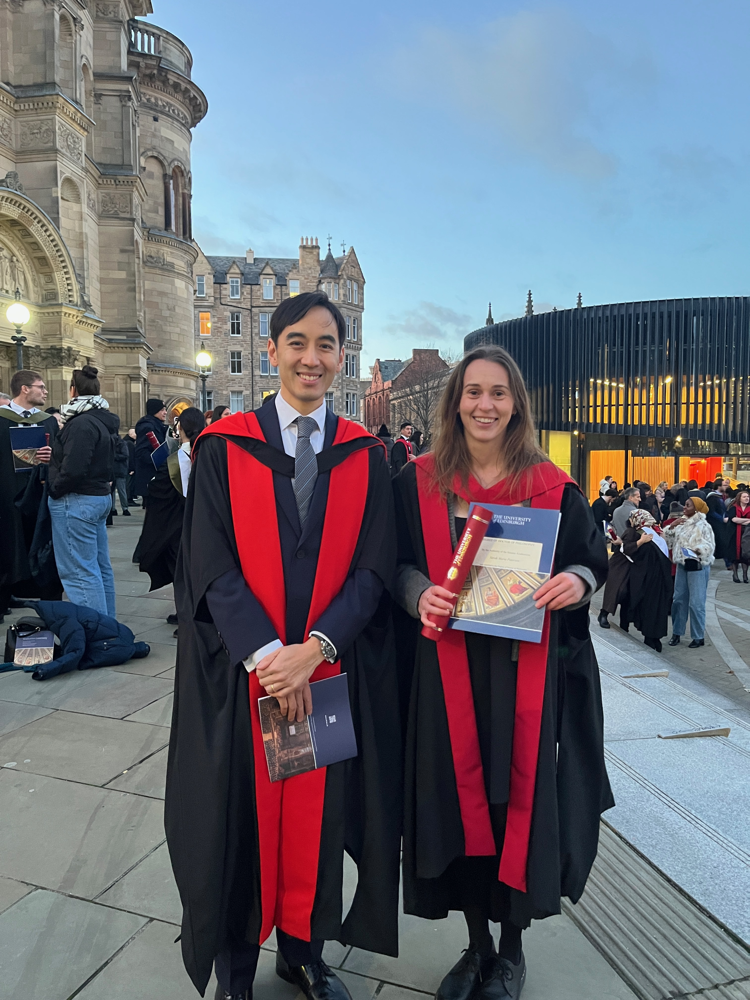
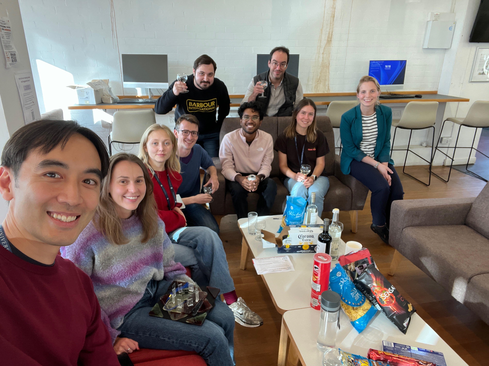
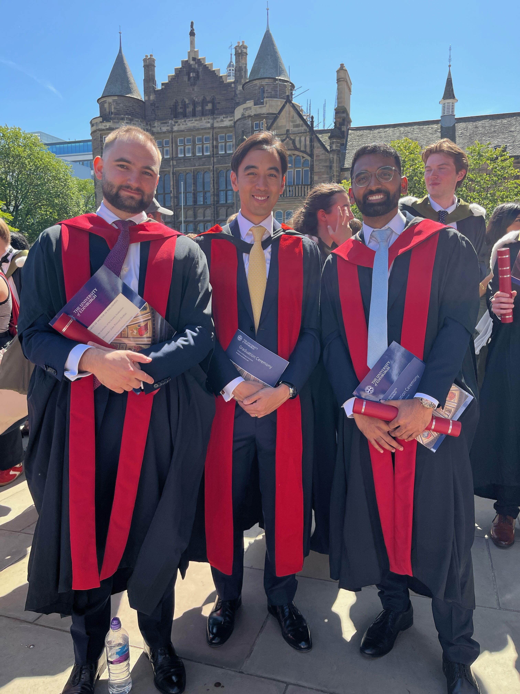
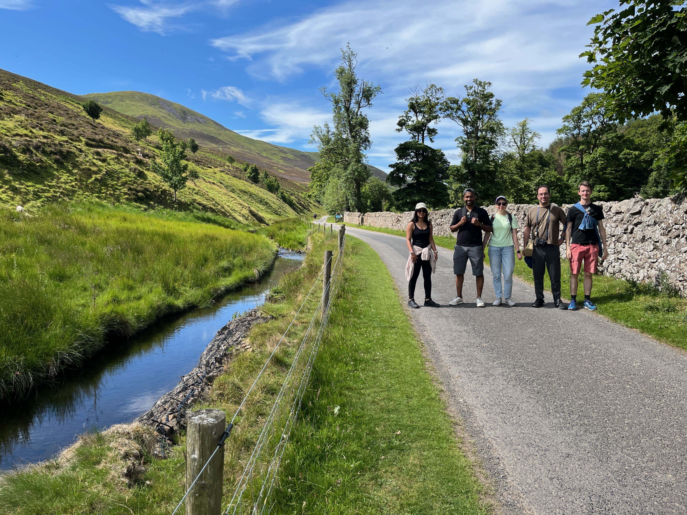
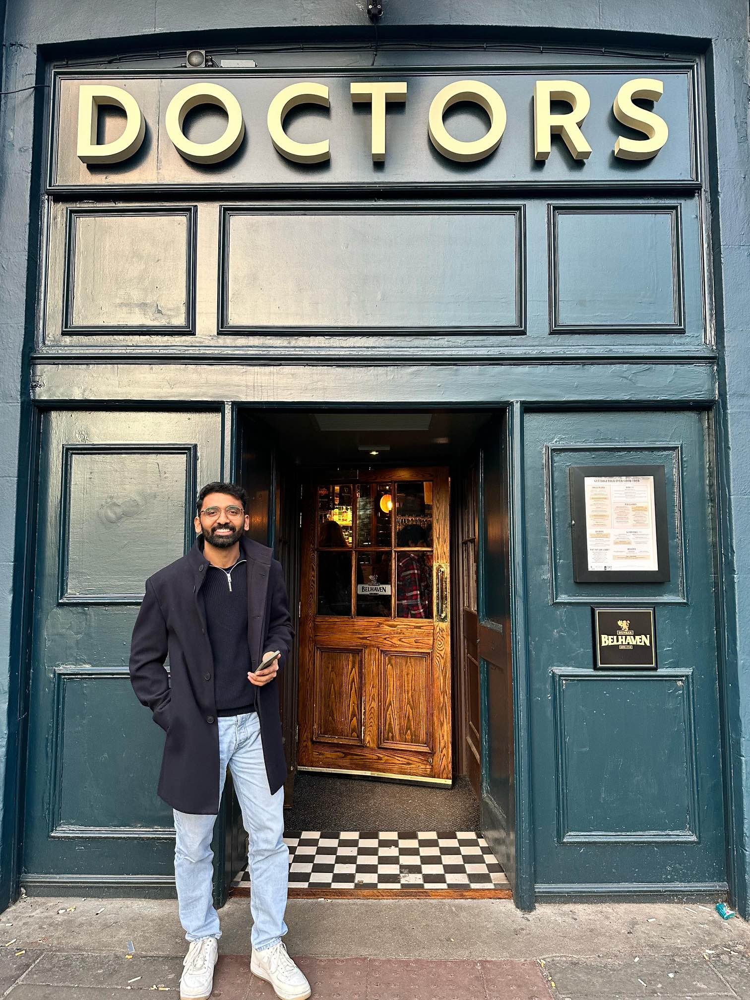

	

		

			
Welcome! We are a research group at <a href="https://www.ed.ac.uk/">The University of Edinburgh</a>. Led by Dr Nadanai Laohakunakorn, our vision is to master the use of <b>cell-free synthetic biology</b> to enable a wide variety of applications in biomanufacturing, biosensing, and healthcare. 

			
Harnessing these simplified mimics of living cells gives us a unique approach to understanding life, by building it up from its most basic components. 

			
Please check back regularly for updates! 

		

		

		<figure>
			
			<figcaption><i>Photo: Z. Swank</i></figcaption>
			</figure>
		

<h3><a href="{{ BASE_PATH }}/pages/news.html">News</a></h3>

<ul>

<li>28 October 2026 &#187; Huge congratulations to Dr Christoph Wagner who successfully defended his thesis today. Thank you to his fantastic co-supervisor Andrea Weiße, and examiners Heinz Koeppl and Peter Swain. Christoph's work on cell-free ribosomal regeneration was hugely ambitious and I think we made big inroads towards tackling this longstanding problem. Stay tuned for future publications on this topic... meanwhile we wish him all the best as he takes up a new postdoctoral position with the Adamala group.</li>

  <figure>
   
   
  </figure>
  

<li>13 August 2026 &#187; Although the weather scuppered our plan for a more ambitious munro bagging trip, we still had a wonderful group hike in the Pentlands.</li>

  <figure>
   
  </figure>
  

<li>7 July 2026 &#187; Aarushi's HRP paper has been published in Synthetic Biology! Find it <a href="https://doi.org/10.1093/synbio/ysag009">here</a>.</li>

<li>28 February 2026 &#187; We say a fond farewell to Tony who leaves us today to take up a research associate post at the Micalis Institute where he will join their Cell-Free Biofoundry team. We wish him all the best for his future career.</li>

<li>18 December 2025 &#187; As we wind down for the holidays we took the time to reflect on and celebrate our many achievements this year at our annual Christmas dinner. Our last piece of good news for 2025 is that Aarushi has submitted the preprint for her work on horseradish peroxidase as an electrochemical reporter for cell-free sensors. Many congratulations to her, and we thank Sahan for all his help together with Jamie Marland for a fantastic collaboration. Read about it <a href="https://doi.org/10.64898/2025.12.17.694927 ">here</a>.</li>

  <figure>
   
  </figure>
  

<li>19 November 2025 &#187; Sarah has just graduated! We wish her all the best for her future adventures.</li>

  <figure>
   
  </figure>
  

<li>22 October 2025 &#187; Congratulations to Sahan for his <a href="https://doi.org/10.3389/fcimb.2025.1690404">perspective piece</a> on applying cell-free for phage therapy, in collaboration with Vishvesh Kulkarni. </li>

<li>25 September 2025 &#187; Many congratulations on a superb achievement: Sarah has passed her viva! Thank you to the examiners, Drs. Henrike Niederholtmeyer and Joanna Sadler. </li>

  

  

    <figure>
     
    </figure>
    

  

<li>22 August 2025 &#187; Our new refined protocol for OnePot PURE and ribosome production is finally published in JoVE: find out more <a href="https://doi.org/10.3791/68826">here</a>! </li>

<li>12 July 2025 &#187; A proud moment for all of us as Alex and Surendra receive their PhDs in a touching ceremony at McEwen Hall.</li>

  

  

    <figure>
     
    </figure>
    

  

<li>10 July 2025 &#187; This year we went to the beautiful Pentlands for our annual lab hike. </li>

  

  

    <figure>
     
    </figure>
    

  

<li>30 April 2025 &#187; Our paper combining cell-free screening of enzymes with machine learning is now <a href="https://doi.org/10.1021/acssynbio.5c00062">published</a>. Fantastic collaboration with the Regan lab, and many congratulations to Ella for her hard work to make this happen.</li>

<li>14 March 2025 &#187; Two for two! Our second PhD student Dr. Surendra Yadav has just passed his viva today. Like Alex, Surendra was a founding member of the group and we will miss not only his expertise but also his cheerful presence. Many thanks to his examiners Christoph Danelon and Elise Cachat, and We wish him all the best for his future career! </li>

  

  

    <figure>
     
    </figure>
    

  

<li>3 March 2025 &#187; We welcome two new members to our group: Dr. Nicoll Zeballos Lema joins us from Stephen Wallace's lab to work on enhancement of PURE systems; and MSc exchange student Shivangi Pandey arrives from Kavita Yadav's group at the Gujarat Biotechnology University to look at cell-free systems for metabolic engineering.</li>

<li>4 January 2025 &#187; Our paper is published in ACS Synthetic Biology: <a href="https://pubs.acs.org/doi/10.1021/acssynbio.4c00697">ATP regeneration from pyruvate in the PURE system</a>. We describe a new ATP regeneration pathway for the PURE system, based on pyruvate and phosphate. Congratulations to everyone who contributed, particularly Surendra, who led the study.</li>

</ul>

